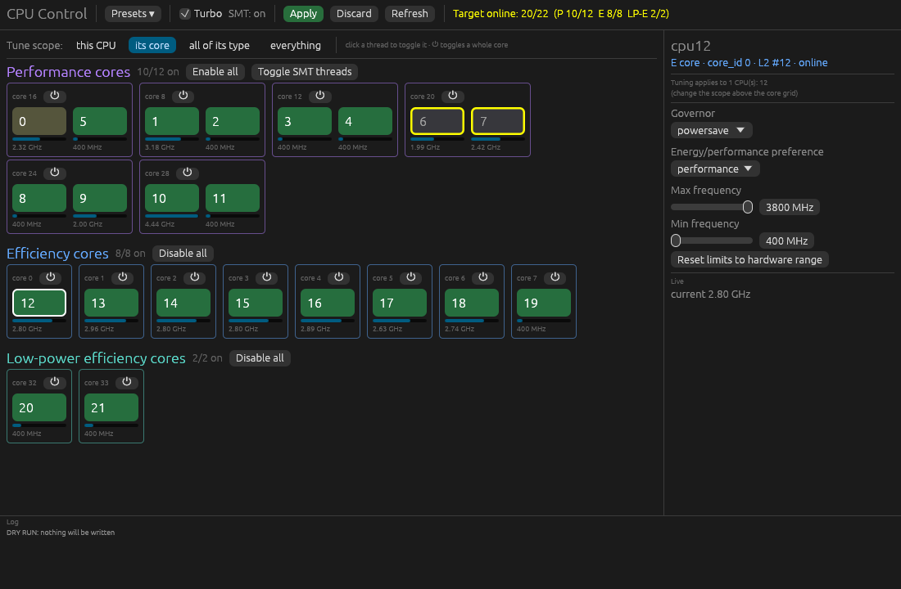

# cpu-control

[](https://github.com/schiz0x00/cpu-control/actions/workflows/ci.yml)
[](#license)

A Linux tool that takes CPU threads offline and brings them back, and sets cpufreq limits, by writing to
`/sys/devices/system/cpu`. It has a command line, a terminal UI and a desktop GUI over the same code.



*The GUI in dry-run mode, showing the development machine's CPUs with one P-core (threads 6 and 7) staged
to go offline. Captured on a virtual display with software rendering.*

It adds no capability the kernel doesn't already expose: everything it does can be done with `echo` into
sysfs as root. What it adds is convenience on hybrid Intel CPUs:

- selectors for groups of CPUs: P-cores, E-cores, LP-E cores, SMT sibling threads, L2 clusters, single cores;
- writes ordered so CPUs come online before others go offline;
- named profiles, built in and in a TOML file;
- UIs where changes are staged and reviewed before anything is written.

## Status

Read this before relying on it.

- **Personal project, version 0.1.0.** No releases, no packages, not on crates.io. You build it from source.
  The command line and the profile format may change.
- **Used on one machine**: an Intel Core Ultra 7 155H (6 P-cores with SMT, 8 E-cores, 2 LP-E cores),
  Ubuntu 26.04, Linux 7.0, `intel_pstate` in active mode. Not every command and code path has been run
  there as root.
- **Everything else is untested on real hardware**: other hybrid generations, non-hybrid Intel, AMD,
  multi-socket machines, other architectures. Code exists for some of these (for example the generic
  `cpufreq/boost` switch where `intel_pstate` is absent) and is covered only by tests against a simulated
  sysfs tree.
- **Core-type detection is a heuristic outside the tested chip.** P and E come from the kernel's
  `cpu_core` / `cpu_atom` PMU lists. LP-E is taken from a `cpu_lowpower` list if the kernel has one,
  otherwise it is "an atom core with no L3 cache". That is right on the 155H; on other generations it may
  label ordinary E-cores as LP-E.

If you run it on anything else, a [hardware report](https://github.com/schiz0x00/cpu-control/issues/new?template=hardware_report.yml)
saying whether it got your CPU right is the most useful contribution there is.

What it is not: it is not a daemon, it keeps nothing across a reboot, and it does not manage process
affinity, cgroups or scheduling. Other power managers (power-profiles-daemon, TLP, tuned and the like)
write the same sysfs files; whichever writes last wins, and this tool does not coordinate with them.

## Is it safe to run?

Everything it changes in the kernel is runtime state. A reboot undoes all of it, and
`sudo cpu-control preset all` brings every CPU back online without one.

What the code guarantees, each covered by tests:

- It refuses any request that would leave zero CPUs online.
- CPUs are brought online first, taken offline second. If a CPU fails to come online, nothing is taken
  offline in that run.
- It writes only to sysfs files that already exist. It never creates a file there.
- Governor and energy-preference values must be plain names (letters, digits, `_`, `-`). Frequencies must
  be between 1 kHz and 100 GHz. CPU ids above 65535 are rejected.
- `--dry-run` / `-n` writes nothing at all, including its own cache.
- A CPU without an `online` file (cpu0 on most x86 systems) is reported as `fixed` and left online.

What it cannot protect you from:

- Offlining CPUs on a busy machine migrates everything running on them. Leaving one slow core online will
  make the system crawl until you undo it.
- **Do not give it passwordless root** (a `NOPASSWD` sudoers entry or a polkit allow rule). `--profiles`
  and the hidden test flag `--sysfs-root` choose which files it reads and writes, so that would amount to
  handing out root.
- `sudo` and `pkexec` run whatever binary is at the path you give them. Running a copy from a directory
  your user can write to (such as `target/release`) means anything running as you can replace it. For
  regular use install a root-owned copy (see [Build](#build)).
- It warns when the online CPU ids would have gaps, because some monitoring tools mishandle that (the
  code notes btop 1.4.6 crashing in that state), but it does not stop you.

## Build

Needs Linux and Rust 1.95 or newer (the GUI dependency sets that floor; 1.96.1 and 1.99.1 are the versions
it has been built and tested with).

```
cargo build --release
./target/release/cpu-control status
```

Optional, for regular use as root:

```
sudo install -m 755 target/release/cpu-control /usr/local/bin/
```

The GUI is built with eframe/egui, which makes the dependency tree large (`Cargo.lock` lists about 550
crates across all platforms). There is currently no way to build without the GUI.

At run time: root for anything that changes state, a graphical session for the GUI, and `pkexec` (polkit)
if you want the GUI to apply changes without being started as root.

## Usage

With no arguments it opens the GUI. Reading (`status`, `select`) and any dry run need no privileges.
Everything that changes state needs root.

```
cpu-control status                    # table of every CPU
cpu-control -n off p                  # show what disabling all P-cores would write
sudo cpu-control off p                # do it
sudo cpu-control only 'p,^smt'        # one thread per P-core, nothing else online
sudo cpu-control set e --max 2ghz     # cap the E-cores at 2 GHz
sudo cpu-control preset all           # everything back online
```

`status` on the development machine (rows 3 to 19 cut):

```
CPU  TYPE  CORE THR L2        STATE         CUR           MIN-MAX  GOVERNOR    EPP
0    P       16 T0  #0        fixed    1.84 GHz  400 MHz-4.50 GHz  powersave   performance
1    P        8 T0  #1        online   2.00 GHz  400 MHz-4.80 GHz  powersave   performance
2    P        8 T1  #1        online    400 MHz  400 MHz-4.80 GHz  powersave   performance
...
20   LP-E    32 T0  #20       online    400 MHz  400 MHz-2.50 GHz  powersave   performance
21   LP-E    33 T0  #20       online    400 MHz  400 MHz-2.50 GHz  powersave   performance

P: 12/12 online  E: 8/8 online  LP-E: 2/2 online  |  total 22/22 online (0-21)
smt=on  turbo=on  intel_pstate=active
cpu0 cannot be taken offline (no hotplug support)
```

### Commands

| command | what it does |
|---|---|
| `status` (`list`, `ls`) | table of every CPU: type, core, thread, L2 cluster, state, frequency, governor, EPP |
| `select <sel>` | print the CPUs a selector resolves to |
| `off <sel>` / `on <sel>` | take the selected CPUs offline / bring them online |
| `only <sel>` | exactly these CPUs online, everything else offline (a `fixed` CPU stays online regardless) |
| `set <sel> [--governor G] [--epp E] [--min F] [--max F]` | per-CPU tuning; `--reset-freq` restores each CPU's hardware min/max |
| `turbo on\|off` | writes `intel_pstate/no_turbo`, or `cpufreq/boost` where that is absent |
| `smt on\|off` | writes the kernel's global switch, `smt/control` |
| `preset [name]` | apply a built-in or saved profile; with no name, list them |
| `profile list\|show\|save\|apply\|delete` | manage saved profiles; `save` snapshots the live state |
| `tui` | terminal UI |
| `gui` | desktop GUI (the default) |

Frequencies: a bare number is MHz; `khz`, `mhz` and `ghz` suffixes are accepted (`800`, `2.4ghz`).

Exit codes: `0` success, `1` at least one write failed (the rest were still attempted), `2` the request
was invalid or refused and nothing was written to sysfs.

### Selectors

Comma-separated terms, evaluated left to right; a term prefixed with `^` is subtracted.

| term | meaning |
|---|---|
| `N`, `A-B` | logical CPU ids |
| `all`, `none` | every CPU, no CPU |
| `p`, `e`, `lpe` | performance, efficiency, low-power efficiency cores (all their threads) |
| `smt` | the second and later hardware threads of each core |
| `primary` | the first hardware thread of each core |
| `core:N` | all threads of the core with kernel `core_id` N |
| `l2:N` | all CPUs sharing an L2 cache with CPU N |
| `online`, `offline` | by current state |

`all,^p` is everything except P-cores; `p,^smt` is one thread per P-core. `cpu-control select <sel>` shows
what an expression means on your machine without changing anything.

### Profiles

Built in: `all`, `no-pcores`, `no-ecores`, `no-lpe`, `pcores-only`, `ecores-only`, `lpe-only`, `no-smt`,
`pcores-no-smt`, `max-perf`, `quiet`. `cpu-control preset` lists them with descriptions.

Your own go in `~/.config/cpu-control/profiles.toml` (or `--profiles FILE`, or `$CPU_CONTROL_PROFILES`):

```toml
[profile.gaming]
description = "P-cores w/o SMT, E-cores capped"
online = "p,^smt,e"       # exactly these end up online
turbo = true
governor = "performance"  # default for every online CPU
epp = "performance"

[[profile.gaming.tune]]   # overrides, applied after the defaults
cpus = "e"
max_freq = "2.4ghz"
```

- `online` makes exactly that set online. `offline` (optional) is subtracted afterwards. With neither, the
  profile does not touch hotplug.
- The top-level `governor` / `epp` / `min_freq` / `max_freq` apply to every CPU that ends up online. That
  includes a CPU the kernel will not take offline (usually cpu0) even when `online` leaves it out.
- Unknown keys are an error, so a typo is reported rather than ignored.
- A saved profile with the name of a built-in one replaces it.
- Applying a profile writes its tuning values even when they already match.

### GUI

Run it as your normal user. Cores are cards grouped by type, one button per hardware thread with a live
frequency bar. Click a thread to toggle it, `⏻` toggles a whole core, and each section has
*Enable/Disable all* and *Toggle SMT threads*. The side panel sets governor, energy preference and min/max
frequency for the selected CPU, its core, its type, or everything. Presets are in the **Presets** menu.

Changes are staged (yellow outline) until you press **Apply**. When the GUI is not root, Apply writes the
staged state to a temp file only your user can read and runs
`pkexec cpu-control --profiles <that file> preset gui-staged`, so you get a polkit password prompt and the
privileged side is the same CLI path as above. `-n` makes the GUI a dry run that logs what it would write.

### Terminal UI

`sudo cpu-control tui`. It has no `pkexec` step, so without root it can show and stage but its writes fail.

Keys: `↑↓`/`jk` move, `space` toggle the CPU, `c` its core, `l` its L2 cluster, `p` / `e` / `o` all
P / E / LP-E cores, `s` SMT threads, `a` everything online, `m` presets, `t` turbo, `g` cycle the governor
and `[` `]` step the max frequency for the core type under the cursor, `w` apply, `u` discard, `r` refresh,
`q` quit. It cannot set the energy preference or a minimum frequency; use `set` or a profile for those.

## How it knows the topology

The kernel removes `topology/` and `cache/` for an offline CPU, drops it from its siblings' lists, and
drops it from the hybrid PMU lists. So for an offline CPU the kernel no longer says which core it belongs
to or what type it is.

The tool therefore records those facts while a CPU is online, in `/var/lib/cpu-control/topology.toml` when
run as root, otherwise `~/.local/state/cpu-control/topology.toml` (override the directory with
`$CPU_CONTROL_STATE_DIR`). The cache is keyed only by the list of present CPUs, so it does not notice a
different machine with the same CPU count.

If a CPU is already offline the first time the tool runs, nothing is known about it: `status` shows `?`
for its type and core, and hotplug commands print a warning. Until it has been seen online once, `p`, `e`
and `smt` treat it as a P-core with a single thread, and `core:N` does not match it.

## Known limitations

- In the GUI and TUI, a CPU that some other tool takes offline or online while the window is open shows
  up as a pending change of yours. Applying would revert it.
- `core:N` matches `core_id` on every socket; multi-socket machines are not handled.
- Under `sudo`, the invoking user's home is looked up in `/etc/passwd` only (no LDAP or systemd-homed).
- After a failed write, the CLI prints both a `did:` line and a `failed:` line for that action.
- `cpu-control status | head` can end with a broken-pipe panic.
- The GUI's whole-core toggle is the `⏻` symbol, which the GUI toolkit's built-in fonts lack. It is drawn
  from a system font (Noto Sans Symbols 2, for example) and shows as an empty box if none has it.

## Tests

```
cargo test
```

At the time of writing that is 162 unit tests and 33 end-to-end tests that run the built binary. All of
them work on a simulated sysfs tree in a temp directory (`tests/support/sysfs_tree.rs`, modelled on the
155H) and never touch the real `/sys`, your profiles or the topology cache. The simulation also performs
the kernel's side effects of taking a CPU offline. Those were checked against the kernel source
(`remove_siblinginfo` in `arch/x86/kernel/smpboot.c`, `cache_shared_cpu_map_remove` in
`drivers/base/cacheinfo.c`, the hybrid PMU code in `arch/x86/events/intel/core.c`), not against a running
kernel.

What the tests do not cover:

- any real kernel or hardware;
- running as root, including the file-ownership fix-up done under `sudo`;
- the `pkexec` path of the GUI;
- clicking in the GUI. Its state logic is tested and every panel is rendered once without a window, but no
  test presses a button. The TUI's key handling and drawing are tested against an in-memory terminal.

CI runs `cargo clippy -- -D warnings` and `cargo test` on Ubuntu with a pinned Rust version.

## Contributing

Issues and pull requests are welcome; see [CONTRIBUTING.md](CONTRIBUTING.md). This is a personal project
maintained in spare time, so there is no promised response time. Changes are listed in
[CHANGELOG.md](CHANGELOG.md).

Because the tool runs as root, please report security problems privately as described in
[SECURITY.md](SECURITY.md) rather than in a public issue.

## License

Licensed under either of

- Apache License, Version 2.0 ([LICENSE-APACHE](LICENSE-APACHE))
- MIT license ([LICENSE-MIT](LICENSE-MIT))

at your option. Both come without warranty of any kind; see the license texts.

Unless you explicitly state otherwise, any contribution intentionally submitted for inclusion in this
project by you, as defined in the Apache-2.0 license, shall be dual licensed as above, without any
additional terms or conditions.
